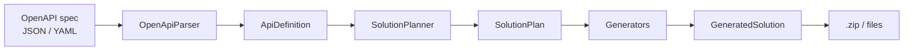

# ApiForge

[](https://github.com/Pilipi1984/api-forge/actions/workflows/build.yml)
[](https://sonarcloud.io/project/overview?id=Pilipi1984_api-forge)
[](https://www.nuget.org/packages/ApiForge.Generator)
[](LICENSE)


**Generate a typed C# client solution from an OpenAPI specification, structured as Clean Architecture or Hexagonal (Ports & Adapters).**

ApiForge takes an OpenAPI 3.x document (JSON or YAML) and produces a complete, ready-to-build multi-project .NET solution: domain models, client contracts, `HttpClient`-based implementations, dependency injection wiring and a runnable client app. Instead of a flat generated client, you get code that already follows the architectural style your project uses.

It can be consumed in two ways:

- as a **NuGet library**, running fully in-process (`ApiForge.Generator`);
- as an **ASP.NET Core Web API**, uploading a spec and downloading a `.zip`.

---

## Table of contents

- [Why ApiForge](#why-apiforge)
- [Quick start](#quick-start)
  - [Use it as a library](#use-it-as-a-library)
  - [Use it as a Web API](#use-it-as-a-web-api)
- [Choosing the architecture](#choosing-the-architecture)
- [What gets generated](#what-gets-generated)
- [How it works](#how-it-works)
- [Repository layout](#repository-layout)
- [Building and testing](#building-and-testing)
- [Continuous integration](#continuous-integration)
- [Current limitations](#current-limitations)
- [Roadmap](#roadmap)
- [Contributing](#contributing)
- [License](#license)

---

## Why ApiForge

Typical OpenAPI client generators emit one big client project with no opinion about how it fits into your application. ApiForge is opinionated about structure:

- **Layered output**: Domain, Application, Infrastructure and Client projects with the correct project references between them.
- **Architecture-aware naming**: contracts and implementations are named and namespaced according to the chosen style (`IPetsClient` / `PetsClient` for Clean, `IPetsClientPort` / `PetsClientAdapter` for Hexagonal).
- **Spec-driven or explicit**: declare the style in the spec with a vendor extension, or force it from code or from the API request.
- **No external tooling**: pure .NET, no Java runtime, no CLI to install.
- **Predictable output**: deterministic naming and folder layout derived from namespaces.

## Quick start

### Use it as a library

```bash
dotnet add package ApiForge.Generator
```

```csharp
using ApiForge.Domain.Enums;
using ApiForge.Generator;

var generator = new ApiForgeGenerator();

await using var spec = File.OpenRead("openapi.yaml");
var zip = await generator.GenerateZipAsync(spec, ArchitectureStyle.Hexagonal);

await File.WriteAllBytesAsync($"{zip.Name}.zip", zip.Content);
```

To work with the files in memory instead of a `.zip`, use `GenerateAsync`, which returns a `GeneratedSolution` with a list of `RelativePath` / `Content` pairs. The `architectureOverride` argument is optional; omit it to let the spec decide.

`ApiForgeGenerator` implements `IApiForgeGenerator`, so it can be registered in a DI container. A constructor accepting your own `IOpenApiParser` and `ICodeGenerator` is available for testing or customization.

### Use it as a Web API

Requirements: **.NET 10 SDK**.

```bash
dotnet run --project ApiForge/ApiForge.Api.csproj --launch-profile https
```

The API listens on `https://localhost:7129` and `http://localhost:5292` (see `ApiForge/Properties/launchSettings.json`). If your browser or `curl` does not trust the development certificate, run `dotnet dev-certs https --trust` once.

**Convert a spec**

```bash
curl -F "file=@./openapi.yaml" \
     -F "architecture=auto" \
     https://localhost:7129/v1/convert \
     --output generated.zip
```

| Field | Required | Description |
|---|---|---|
| `file` | yes | OpenAPI spec in JSON or YAML. Maximum size: 5 MB. |
| `architecture` | no | `auto` (default), `clean` or `hexagonal`. Values are case-insensitive. |

Responses: `200` with `application/zip`, or `400` with `{ "error": "..." }` when the file is missing, the architecture value is unrecognized, or generation fails.

**Health check**

```bash
curl https://localhost:7129/v1/status
```

Returns the API status, version, environment, current UTC timestamp and uptime.

## Choosing the architecture

The style is resolved in this order, first match wins:

1. **Explicit override**: the `architecture` field of the API, or the `architectureOverride` argument of the library.
2. **`x-architecture` extension** in the spec, at the document root or inside `info`.
3. **Tag heuristic**: if any tag name contains `port`, `adapter`, `driven` or `driving`, Hexagonal is assumed. This is a best-effort fallback and never overrides an explicit value.
4. **Clean Architecture**, as the default.

```yaml
openapi: 3.0.0
x-architecture: hexagonal   # hexagonal | ports-and-adapters | clean | clean-architecture
info:
  title: Shop
  version: 1.0.0
```

## What gets generated

For a spec titled `Shop` with a `/pets` group of endpoints:

```
Shop.sln
Shop.Domain/              Models (Shop.Domain/Models/*.cs)
Shop.Application/         Client contracts
Shop.Infrastructure/      HttpClient implementations + DI registration
Shop.Client/              Console app wiring everything together
```

The solution name and root namespace come from `info.title`, sanitized into a valid namespace (fallback: `GeneratedApi`).

| | Clean | Hexagonal |
|---|---|---|
| Contract | `Shop.Application/Interfaces/IPetsClient.cs` | `Shop.Application/Ports/Driven/IPetsClientPort.cs` |
| Implementation | `Shop.Infrastructure/Clients/PetsClient.cs` | `Shop.Infrastructure/Adapters/Driven/PetsClientAdapter.cs` |
| DI extension | `Shop.Infrastructure/DependencyInjection/ServiceCollectionExtensions.cs` | `Shop.Infrastructure/Adapters/DependencyInjection/ServiceCollectionExtensions.cs` |
| DI method | `AddShopClients(...)` | `AddShopAdapters(...)` |

### Generation rules

- **Grouping**: endpoints are grouped by the first non-parameter segment of the route (`/pets/{id}` goes into `Pets`). Routes without one go into `Root`.
- **Method names**: PascalCase `operationId` plus the `Async` suffix. Without an `operationId`, the HTTP method and route are combined. Duplicates get a numeric suffix.
- **Parameters**: ordered as path, query, header, request body, then `CancellationToken`. Optional parameters are nullable.
- **Folder layout**: derived from the namespace of each file, so folders always mirror namespaces.

| OpenAPI | C# |
|---|---|
| `string` | `string` |
| `string` + `date-time` | `DateTimeOffset` |
| `string` + `date` | `DateOnly` |
| `string` + `uuid` | `Guid` |
| `integer` | `int` |
| `integer` + `int64` | `long` |
| `number` | `double` |
| `number` + `float` | `float` |
| `boolean` | `bool` |
| `array` | `List<T>` |
| `$ref` | generated model type |

### Example

Generated contract:

```csharp
public interface IPetsClient
{
    /// <summary>
    /// Gets a pet
    /// </summary>
    Task<Shop.Domain.Models.Pet> GetPetAsync(int petId, int? limit, string? traceId, CancellationToken cancellationToken = default);

    Task<string> CreatePetAsync(Shop.Domain.Models.Pet request, CancellationToken cancellationToken = default);
}
```

Registering the generated clients in a consuming application:

```csharp
services.AddShopClients(new Uri("https://api.example.com"));
```

## How it works



1. **Parse**: `OpenApiParser` reads the document with `Microsoft.OpenApi` and maps it to an internal `ApiDefinition` (models, endpoints, parameters, schemas, detected architecture).
2. **Plan**: `SolutionPlanner` groups endpoints into clients, resolves method names, parameter names and C# types, and computes namespaces from the `ArchitectureConventions` of the selected style.
3. **Generate**: dedicated generators emit project files, domain models, contracts, implementations, DI registration and `Program.cs`.
4. **Package**: `ApiForgeGenerator` returns the in-memory solution or zips it.

Adding a new architecture style is a matter of defining its `ArchitectureConventions` (namespace suffixes and naming functions); the generators do not branch on style.

## Repository layout

| Project | Responsibility |
|---|---|
| `ApiForge/` (`ApiForge.Api`) | ASP.NET Core Web API: `/v1/convert` and `/v1/status`. |
| `ApiForge.Generator/` | Public in-process entry point, published as a NuGet package. |
| `ApiForge.Infrastructure/` | OpenAPI parser, planning and code generators. |
| `ApiForge.Application/` (`ApiForge.ApplicationCore`) | Interfaces and contracts (`IApiForgeGenerator`, `IOpenApiParser`, `ICodeGenerator`) and DTOs. |
| `ApiForge.Domain/` | Domain models: API definition, schemas, parameters, generated solution. |
| `ApiForge.Tests/` | xUnit v3 unit and integration tests. |

Dependencies flow inwards: `Domain` has no project dependencies, `Application` depends on `Domain`, and `Infrastructure`, `Generator` and `Api` build on top.

## Building and testing

Prerequisites: **.NET 10 SDK** (`dotnet --version` should report 10.x).

```bash
dotnet restore
dotnet build ApiForge.sln -c Debug
dotnet test --solution ApiForge.sln -c Debug
```

The tests run on Microsoft.Testing.Platform (configured in `global.json`), which is why the solution is passed with `--solution`.

A `Dockerfile` is also provided. It builds the solution, runs the tests and produces a coverage report:

```bash
docker build -t apiforge-build .
```

If Test Explorer in Visual Studio cannot find the tests, rebuild the solution and delete the `.vs`, `bin` and `obj` folders to clear stale project metadata.

## Continuous integration

GitHub Actions workflows run on every push and pull request:

- **Build and analyze**: builds the solution, runs the tests with coverage and sends the analysis to SonarQube Cloud.
- **Publish NuGet**: on a `v*` tag, builds, tests, packs and publishes to nuget.org using Trusted Publishing (OIDC), with no long-lived API key. Versions are derived from Git tags with [MinVer](https://github.com/adamralph/minver).

To release, create and push a tag:

```bash
git tag v1.0.X
git push origin v1.0.X
```

## Nuget packages

[](https://www.nuget.org/packages/ApiForge.Application) ApiForge.Application

[](https://www.nuget.org/packages/ApiForge.Domain) ApiForge.Domain

[](https://www.nuget.org/packages/ApiForge.Generator) ApiForge.Generator

[](https://www.nuget.org/packages/ApiForge.Infrastructure) ApiForge.Infrastructure

## Current limitations

- Only the first response and the first content type of each operation are used.
- Cookie parameters are parsed but not emitted in the generated clients.
- Enums are generated as `string`; inline object schemas resolve to `object`.
- Model properties are mapped from primitive types; nested `$ref` or array properties fall back to `object`.
- Generated projects target `net10.0`.

## Roadmap

The roadmap is directional rather than a commitment, and priorities may change based on feedback. Ideas and votes are welcome through [issues](https://github.com/Pilipi1984/api-forge/issues).

### Done

- [x] OpenAPI 3.x parsing (JSON and YAML) with `Microsoft.OpenApi`
- [x] Clean Architecture and Hexagonal (Ports & Adapters) output
- [x] Architecture selection via `x-architecture`, tag heuristic or explicit override
- [x] In-process library (`ApiForge.Generator`) and Web API (`/v1/convert`)
- [x] CI with tests, coverage and static analysis

### Next

- [ ] Generate real C# `enum` types from enum schemas
- [ ] Generate types for inline object schemas instead of falling back to `object`
- [ ] Support nested `$ref` and array properties in domain models
- [ ] Emit cookie parameters in generated clients
- [ ] Handle multiple responses and content types per operation

### Under consideration

- [ ] Schema composition: `allOf`, `oneOf` and `anyOf`
- [ ] `[JsonPropertyName]` attributes to preserve the original property names
- [ ] Authentication helpers (API key, bearer token) in generated clients
- [ ] Typed error handling for non-success responses
- [ ] Configurable target framework and package versions for the generated solution
- [ ] A `dotnet tool` for command-line generation
- [ ] Additional architecture styles through new `ArchitectureConventions`

## Contributing

Contributions are welcome.

1. Fork the repository and create a branch for your change.
2. Add or update tests for any new generator or parser behavior.
3. Make sure `dotnet build` and `dotnet test --solution ApiForge.sln` pass.
4. Open a pull request describing the change and its motivation.

Please read the [Code of Conduct](CODE_OF_CONDUCT.md) before participating.

## License

Distributed under the [MIT License](LICENSE).
